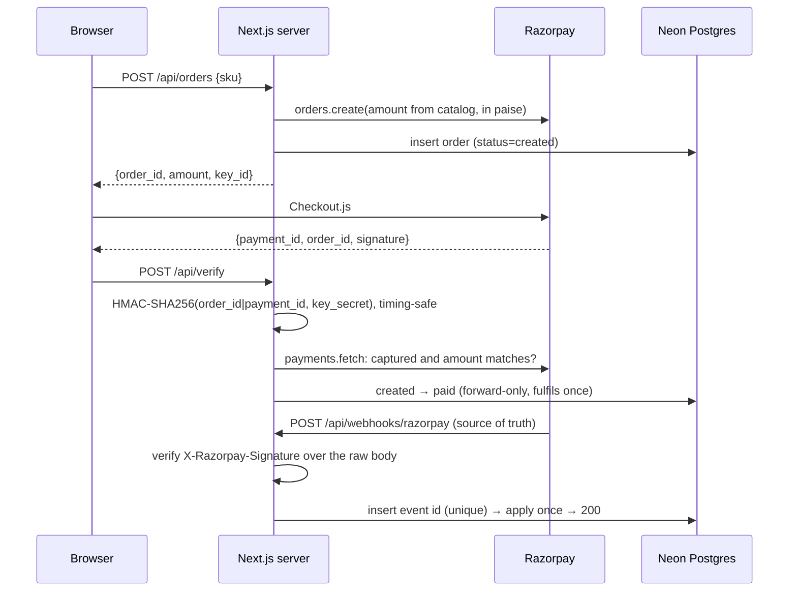

# Integration Clinic

A public demo store on Razorpay **test mode** that breaks on purpose. Run a correct payment end to end, then flip a switch to run the same action with a common merchant mistake. You see the real request and response, the root cause and the fix side by side, plus a short troubleshooting doc for each mistake.

**Live:** _add your Vercel URL here_

 <!-- record and add docs/demo.gif -->

> Unofficial demo, not affiliated with Razorpay. Test mode only: no real money moves.

## Scenarios

| # | Mistake | Broken route | What you see | Fix |
|---|---|---|---|---|
| 1 | Rupees instead of paise | `/api/broken/amount` | ₹4.99 order for a ₹499 item; a real 400 for `499.5` | One `toPaise()` helper: `Math.round(rupees * 100)` |
| 2 | Skipping server-side verification | `/api/broken/confirm` | Order paid with a fake payment id | HMAC check + `payments.fetch` status and amount |
| 3 | Trusting the client for the price | `/api/broken/client-order` | ₹1 order for a ₹999 item | Client sends only `sku`; server owns the price |
| 4 | Wrong or mixed keys | `/api/broken/keys` | Real `401 Authentication failed` | Env vars + key-prefix guard |
| 5 | Non-idempotent webhook | `/api/broken/webhook` | `fulfilment_count = 2` after a replay | Dedupe on `X-Razorpay-Event-Id`, forward-only status |
| 6 | Parsing JSON before verifying | `/api/broken/webhook-parsed` | Signature mismatch with the right secret | `await req.text()`, verify, then parse |
| 7 | Refunding more than captured | `/api/broken/refund` | Real 400 from the refunds API | Validate against the captured amount first |
| 8 | Order stuck after closing the modal | (Checkout options) | "Waiting for payment…" forever | Handle `ondismiss` and `payment.failed` |

Scenarios #1, #4 and #7 hit the real test API. #2, #3, #5 and #6 are flaws in server logic, demonstrated against deliberately vulnerable `/api/broken/*` routes. For #5 and #6, the server signs a synthetic event with the webhook secret, and the browser posts it.

## Architecture



- `/verify` is fast feedback for the buyer. The webhook is the source of truth. Both go through one forward-only `advanceOrder()` in `lib/db.ts`, so they can arrive in either order and the order is still fulfilled exactly once.
- All state is scoped by an `ic_session` cookie, so visitors don't clobber each other's demos.
- `lib/scenarios.ts` drives the scenario pages. Adding a scenario costs one entry, one route and one `case` in `app/components/ScenarioRunner.tsx`.

```
app/page.tsx                      store, scenario picker, your orders
app/scenarios/[slug]/page.tsx     the three panels + Broken ⇄ Fixed runner
app/docs/*/page.mdx               troubleshooting pages and guides
app/api/{orders,verify,refunds,payment-links}/route.ts
app/api/webhooks/razorpay/route.ts
app/api/broken/*/route.ts         deliberately vulnerable routes
app/api/scenarios/replay-webhook  signs a synthetic event for #5 and #6
lib/{catalog,razorpay,db,scenarios,checkout}.ts
proxy.ts                          session cookie + per-IP rate limit
db/schema.sql                     2 tables, raw SQL, no ORM
```

## Run it locally

Requirements: Node 20.12 or newer, a Razorpay account in test mode, and a Neon Postgres database.

1. `npm install`
2. `cp .env.example .env.local` and fill in:
   - `RAZORPAY_KEY_ID`, `RAZORPAY_KEY_SECRET`: Razorpay dashboard → Test Mode → API Keys.
   - `RAZORPAY_WEBHOOK_SECRET`: any string. Use the same one when you add the webhook (step 5).
   - `DATABASE_URL`: the Neon pooled connection string.
3. Apply the schema: paste `db/schema.sql` into the Neon SQL editor, or run `psql "$DATABASE_URL" -f db/schema.sql`.
4. `npm run dev`, then open http://localhost:3000. The test card is `4111 1111 1111 1111`, with any future expiry and any CVV.
5. Webhooks: run `ngrok http 3000`, then in Razorpay (Test Mode) → Webhooks, add `https://<ngrok-host>/api/webhooks/razorpay` with your secret and the events `payment.captured`, `payment.failed`, `payment_link.paid` and `refund.processed`.

Tests: `npm test`. The HMAC and `toPaise` groups always run. The webhook dedupe test runs when `DATABASE_URL` is set.

The Postman collection for the correct flow is at [`public/integration-clinic.postman_collection.json`](public/integration-clinic.postman_collection.json), and the site links to it in the footer.

## Deploy (Vercel)

1. Import the repo into Vercel and set the four env vars for **Production**.
2. Register the Razorpay test-mode webhook against the **production** URL. Deployment Protection on preview URLs blocks Razorpay's calls.
3. Every Razorpay route sets `export const runtime = 'nodejs'`, because the SDK doesn't run on the Edge runtime.

## Known limits

- The rate limit (20 POSTs per minute per IP, webhooks exempt) is in-memory per instance. It blunts casual spam, but it isn't shared across serverless instances.
- The webhook payload field paths follow Razorpay's documented event shapes. Check them against a real delivery stored in `webhook_events.payload`.
